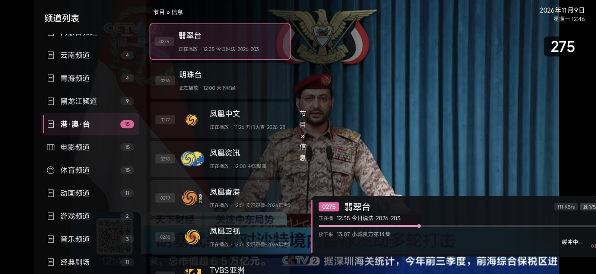
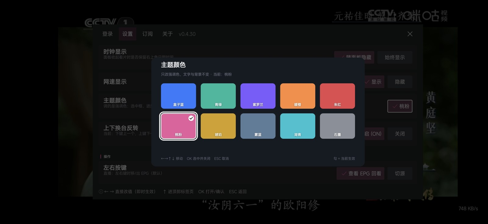
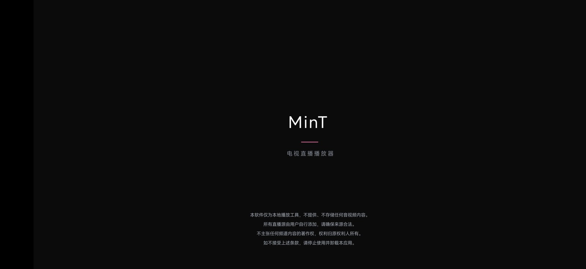
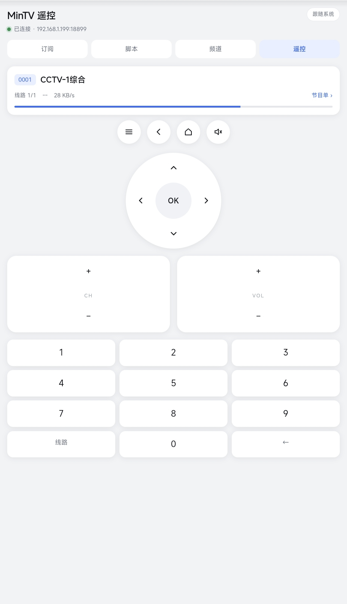

# MinTV

<div align="center">

**轻巧、流畅、为遥控器而生的电视直播播放器**

<br>

安装简单，无需注册，即开即用

<br>

[**▶ 下载**](#下载)　·　[功能介绍](#功能)　·　[安装指南](#安装)　·　[添加订阅](#添加订阅)

</div>

<br>

<div align="center">



<sub>订阅 · 分类 · 频道 三级导航，右侧常驻节目信息</sub>

</div>

<br>

---

## 为什么是 MinTV

电视盒子普遍硬件有限：内存小、CPU 弱、遥控器只有几个按键。

大多数播放器把手机界面放大塞进电视，结果是大块卡片、层层菜单、焦点乱跳。
MinTV 从第一行代码起就按**遥控器**设计 —— 每一次按键的落点、返回的位置、
按下去会发生什么，都推演过。

同时，我们尽量不浪费设备的每一分性能：多余的后台任务不做，
界面只在内容真的变化时才重绘，调试代码在发布版中全部移除。
这些看不见，却决定了在低端设备上「卡」还是「不卡」。

---

## 设计理念

**遥控器优先，不是把手机界面放大。**

电视上没有触摸，一切操作都要靠方向键和 OK 完成。所以焦点顺序、返回逻辑、
「按下去会发生什么」的可预期性，比视觉花哨重要得多。这个应用里每一条
导航路径都想「用遥控器走一遍顺不顺」。

**信息该藏的时候藏，该给的时候给。**

平时看画面，界面就该干净。要参数时按一下 INFO，分辨率、编码、码率、
解码方式、播放地址、代理状态一次给全 —— 不用去翻设置，也不占常看的界面。

**能自愈的，不让用户动手。**

起播超时、无画面、卡顿、跟不上直播 —— 四种情况各有对应的自动处理：
换解码方式、换线路、换协议。用户看到的只是「闪了一下，然后继续播」。

**失败要说清楚，不含糊。**

源连不上就是「源服务器连不上」，配了代理但当前源走不了就是
「本路 UDP 源过不了代理，实际直连」。不让人对着黑屏猜。

**能做的地方都省了。**

启动不做多余的事：日志在发布版里全清干净，列表用 View 池复用，
界面只在内容真变时重绘。这些用户看不见，但在低端盒子上就是
「卡不卡」的区别。

**主题不只是一个色块。**

十套配色，从冷静的盒子蓝到活泼的桃粉。焦点框、进度条、信息面板、
分类胶囊、选中态全部跟着变，不是简单换个按钮颜色。

而且底色不是死的：面板会根据主题自动算明暗，保证十套配色下
白字对比度都在 9:1 以上（WCAG AAA 标准是 7:1）。挑哪套都不糊。

---

## 功能

<table>
<tr>
<td width="50%" valign="top">

### 播放

- 多内核兜底，自动降级
- 起播超时 / 无画面 / 卡顿 / 掉速自动换线路
- 自定义请求头（UA、Referer）
- 画面比例、逐帧步进、倍速
- 回看自动探测

</td>
<td width="50%" valign="top">

### 界面

- 订阅 · 分类 · 频道 三级导航
- 信息面板：按 INFO 键调出
- 十套主题色，全局跟随
- 手机遥控：局域网浏览器控制
- EPG 节目单

</td>
</tr>
<tr>
<td valign="top">

### 网络

- SOCKS5 / HTTP 代理（支持账号密码）
- RTSP/RTMP 可走本地转发桥
- UDP 源不支持代理时会明确提示

</td>
<td valign="top">

### 其它

- 脚本引擎：JavaScript 写源规则，热更新
- 存储目录可选（SAF），文件管理器可见
- 开机自启
- Android 4.4 起支持

</td>
</tr>
</table>

---

## 支持的源

| 类型 | 说明 |
|---|---|
| m3u / m3u8 / txt | 标准直播源列表 |
| HLS 直播 | ts / fMP4 |
| RTSP / RTMP | 内置转封装 |
| UDP / RTP / 组播 | 内置转封装 |
| 回看 | 支持 `catchup-source` 模板 |

---

## 截图

<div align="center">



<sub>十套主题色，选中即刻生效 —— 文字与背景不变，只换强调色</sub>

<br><br>



<sub>启动页</sub>

<br><br>



<sub>手机遥控 —— 局域网内用浏览器控制，不用装 App</sub>

</div>

---

## 下载

| 文件 | 说明 |
|---|---|
| [app-armeabi-v7a.apk](https://raw.githubusercontent.com/XiaoZhang5656/mintv-apk/main/app-armeabi-v7a.apk) | 当前版本，已签名 |

直链（可给电视盒子 / 第三方市场用）：

```
https://raw.githubusercontent.com/XiaoZhang5656/mintv-apk/main/app-armeabi-v7a.apk
```

版本信息：<https://raw.githubusercontent.com/XiaoZhang5656/mintv-apk/main/version.json>

---

## 安装

1. 下载上面的 APK
2. 允许「安装未知来源应用」
3. 覆盖安装即可（签名固定，不用卸载）

**最低版本**：Android 4.4（API 19）

**电视盒子**：用 U 盘拷进盒子，或用盒子上自带的文件管理器安装。

---

## 添加订阅

用手机浏览器打开 App 里的「手机助手」地址，
或者在设置里选「存储目录」，把 m3u / txt 文件丢进 `sources/` 目录。

标准 IPTV 列表格式：

```m3u
#EXTM3U
#EXTINF:-1 tvg-name="CCTV-1" group-title="央视",CCTV-1 综合
http://example.com/cctv1.m3u8
```

需要特定请求头的源：

```m3u
#EXTINF:-1 group-title="卫视",湖南卫视
#EXTVLCOPT:http-user-agent=Mozilla/5.0
#EXTVLCOPT:http-referrer=http://example.com/
http://example.com/hunan.m3u8
```

带回看声明：

```m3u
#EXTM3U catchup-source="?playseek=${(b)yyyyMMddHHmmss}-${(e)yyyyMMddHHmmss}"
#EXTINF:-1 catchup="default",CCTV-1
http://example.com/cctv1.m3u8
```

---

## 常见问题

**Q：为什么有些源播不了？**

源本身失效、需要特定网络环境（比如运营商内网）、或者需要只对特定地区开放的。
应用会自动尝试换线路和解码方式，都失败就是源的问题。

**Q：信息面板里没有分辨率？**

部分直播流的封装里不带尺寸信息，播放内核拿不到。属于源的问题，不影响播放。

**Q：配了代理但感觉没生效？**

`udp://` `rtp://` `srt://` 这几种源过不了代理，应用会直连并在面板里明确标注。

**Q：Android 10 以上开机不自启？**

系统限制后台启动界面。需要在系统设置里给应用开「自启动 / 后台弹出界面」权限，
或者把它设为默认桌面。

---

## 手机遥控与扫码

<div align="center">


*手机浏览器打开后就是这个界面*

</div>

### 怎么连

电视端打开「设置 → 手机助手」，会显示一条地址和一个二维码：

```
http://192.168.1.199:18899
```

**扫码**：用手机扫电视上的二维码，直接打开遥控页。

**手动输**：手机和电视连同一个 WiFi，浏览器输上面那个地址。

**地址在变**：IP 随网络变化；18899 被占用时端口会切到 18900。
所以输地址前先看一眼电视上显示的完整 URL，不要凭记忆输。

### 能做什么

| 页面 | 功能 |
|---|---|
| **遥控** | 方向键 / OK / 返回 / 主页 / 菜单 / 静音 / 音量 / 换台 / 数字键直选 / 切线路 |
| **订阅** | 增删改订阅源，设置当前使用的订阅 |
| **频道** | 浏览频道列表，搜索，直接点播 |
| **脚本** | 上传 / 编辑 / 删除 JS 脚本，看脚本日志 |

遥控页顶部实时显示当前频道、线路位置和网速，不用回电视看。

### 支持哪些按键

完整映射：`UP` `DOWN` `LEFT` `RIGHT` `OK` `BACK` `HOME` `MENU` `MUTE`
`VOL_UP` `VOL_DOWN` `CH_UP` `CH_DOWN` `LINE`（切线路）。

### 注意

- 遥控是**局域网直连**，不走云端，外网访问不了
- 没有密码保护 —— 同一 WiFi 下的人都能操作，别在不信任的网络里开

---

## 代理

支持 **SOCKS5 / SOCKS4 / HTTP**，可选账号密码。

### 格式

```
socks5://1.2.3.4:1080
socks5://用户名:密码@1.2.3.4:1080
http://用户名:密码@proxy.example.com:8080
```

不写协议默认按 `socks5://` 处理。密码里有 `@` `:` 这类字符时用
百分号转义（`@` → `%40`，`:` → `%3A`）。

### 哪些流量会走代理

| 源类型 | 是否走代理 |
|---|---|
| HTTP / HTTPS / HLS | ✅ 走 |
| RTSP / RTMP | ✅ 走（经本地转发桥） |
| UDP / RTP / SRT / 组播 | ❌ **走不了**，只能直连 |

UDP 类源过不了代理是因为代理协议只转发 TCP。配了代理遇到 UDP 源时，
信息面板里会明确写「本路 UDP 源过不了代理，实际直连」，不会让你以为走了代理。

### 怎么看代理有没有生效

播放时按 **INFO** 键（或点 OSD 上的「详情」），看面板里的「代理」一项：

```
代理     socks5://1.2.3.4:1080
```

配了但地址写错，会显示 `配置无效：具体原因`。

---

## JS 脚本引擎

用 JavaScript 写源解析规则。改脚本不用重装 APK，保存即生效。

### 最小例子

放一个 `my.js` 到存储目录的 `scripts/` 下：

```javascript
exports.name = "我的源";
exports.path = "/my.m3u8";

function main(item) {
    return "http://example.com/live.m3u8";
}
```

保存后订阅列表里会出现「我的源」，点进去就能播。

### 三种脚本形态

```javascript
// ① 正常订阅：设置页和频道列表都显示
exports.name = "河南电信";
exports.path = "/henan.m3u8";

// ② 只应用：设置页显示「已应用」，频道列表不出现
//    适合给播放器挂代理、改请求头这类不需要选源的
exports.apply = true;
exports.path = "/proxy.m3u8";

// ③ 都不写：不注册订阅，路由照常工作
//    用户自己去订阅里加 http://127.0.0.1:18899/secret.m3u8
exports.path = "/secret.m3u8";
```

### main 能拿到什么

```javascript
function main(item) {
    // item.url      "mintv://script/my.js?ch=cctv1"
    // item.query    "ch=cctv1"
    // item.params   { ch: "cctv1" }
    return "播放地址";
}
```

### 能返回什么

```javascript
// 1. 一个地址
return "http://example.com/live.m3u8";

// 2. 多个候选，按顺序试
return { urls: ["http://a.m3u8", "http://b.m3u8"] };

// 3. 带请求头 / 带代理
return {
    url: "http://example.com/live.m3u8",
    headers: { "User-Agent": "Mozilla/5.0", "Referer": "http://example.com/" },
    proxy: "socks5://1.2.3.4:1080"
};
```

### 内置函数

| 函数 | 用途 |
|---|---|
| `fetch(url, init)` | HTTP 请求，返回 `{code, body, headers, error}` |
| `md5(str)` | MD5 摘要，算签名用 |
| `storage.get(k)` / `storage.set(k, v)` | 跨调用持久化，单值上限 64KB |
| `log.info` / `log.warn` / `log.error` | 写进「设置 → 脚本日志」 |
| `require("./lib/x.js")` | 加载模块 |

### 一个完整例子

```javascript
exports.name = "某平台直播";
exports.path = "/demo.m3u8";

function main(item) {
    var ch = item.params.ch || "cctv1";

    // 带签名的请求
    var ts = Math.floor(Date.now() / 1000);
    var sign = md5("appkey" + ts + "secret");

    var r = fetch("http://api.example.com/play", {
        method: "POST",
        headers: { "Content-Type": "application/json" },
        body: JSON.stringify({ ts: ts, sign: sign, ch: ch })
    });

    if (r.code !== 200) {
        log.error("接口失败 " + r.code + " " + r.error);
        return null;
    }
    return JSON.parse(r.body).url;
}
```

订阅里写 `http://127.0.0.1:18899/demo.m3u8?ch=cctv1` 就能用。

### 注意

- `fetch` 是**同步阻塞**的，别在循环里批量请求
- 脚本执行有 8 秒超时，超时后本次解析失败、回源播放
- 脚本文件和 APK 一样放在设备上，注意来源

---

---

## 已知限制

| 项 | 说明 |
|---|---|
| 代理不覆盖 UDP | `udp://` `rtp://` `srt://` 源无法走代理，配了也是直连，界面会写明 |
| Android 10+ 自启 | 系统限制后台启动 Activity，需要手动开权限，或设为默认桌面 |
| 部分源拿不到分辨率 | 播放内核不返回尺寸时，信息面板不显示这一项 |
| 部分私有协议源 | 某些源用 `tvbus://` 这类私有协议，依赖第三方服务器，对方服务不可用时无法播放 |

---

## 反馈

提 Issue 请附上：

1. 设备型号 + Android 版本
2. 出问题的频道地址（可脱敏）
3. App 内「关于 → 日志」的导出内容

---

<div align="center">
<sub>本软件仅为本地播放工具，不提供、不存储任何音视频内容。<br>
所有直播源由用户自行添加，请确保来源合法。</sub>
</div>
